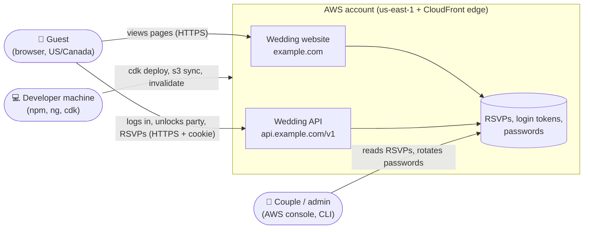
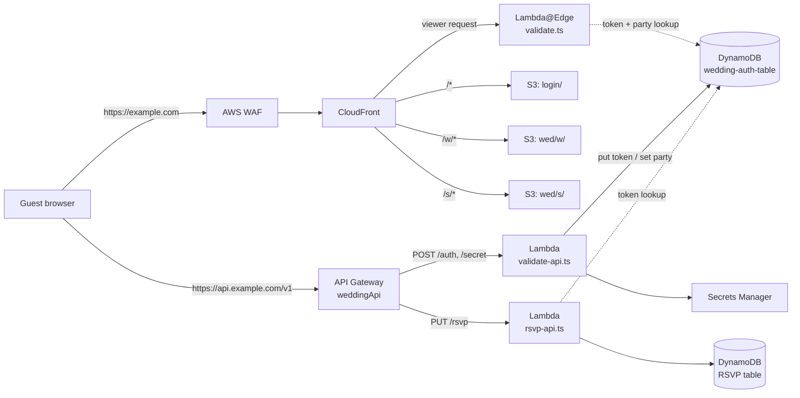

# The Original Wedding Website — Project Documentation

> **These docs describe the original production system, not the demo in this repo.** That system is retired and no longer deployed, and its four repos are private. The demo replaces its whole backend with code that runs in the browser; the [root README](../README.md) explains how the two differ. Source paths below (such as `wedding-cdk/lambda/validate.ts`) refer to the private repos.

A password-protected wedding website. It is built from three Angular front-end apps and one AWS CDK infrastructure project.

Guests land on a login page, enter a shared password, and get a 60-day `api-token` cookie. That cookie unlocks the main wedding site which covers the party details, RSVP, story, travel, and registry. A second, "hidden" after-party site needs a second password. Entering it marks the guest's token as party-approved on the server.

## The four projects

| Folder | What it is | Served at |
|---|---|---|
| `wedding-cdk/` | AWS CDK app (TypeScript): DNS, TLS, CloudFront, WAF, S3, API Gateway, Lambda, DynamoDB, plus the Lambda source and its Jest tests | `api.example.com/v1` (API) |
| `wedding-login/` | Angular 21 app: the password login page | `/` |
| `wedding/` | Angular 21 app: the main wedding site | `/w/*` |
| `wedding-secret/` | Angular 21 app: the hidden after-party page | `/s/*` |

## Documentation index

| Doc | Read it for | Diagrams |
|---|---|---|
| [Architecture](architecture.md) | AWS resources, CDK stacks, CloudFront behaviours, S3 layout | Container view, stack dependencies, region view |
| [Components](components.md) | What is inside each repo and how the parts depend on each other | Lambda module graph, Angular component trees, cross-app navigation |
| [Request flows](request-flows.md) | What happens to each kind of request, end to end | Edge decision tree, page and asset loads, RSVP, CORS, throttling, expiry |
| [Authentication](auth-flow.md) | Login, the after-party unlock, tokens and cookies | Login and party sequences, token lifecycle, cookie scope |
| [Data model](data-model.md) | DynamoDB tables, the secret, who reads and writes what | Entity diagram, read/write map |
| [Security](security.md) | Trust boundaries, IAM permissions, cookie and CORS settings, PII | Trust boundary diagram |
| [API reference](api.md) | The `/auth`, `/secret` and `/rsvp` endpoints | Endpoint → Lambda → table map |
| [Front-end apps](frontend-apps.md) | The three Angular projects, their routes, and why their base paths matter | Build output → S3 → URL map |
| [Build & deployment](deployment.md) | How to build each piece and get it live | Build and deploy pipeline |

## System context

Who and what the system talks to. Everything inside the dashed box is in one AWS account.

## One-paragraph summary

All page traffic enters through a **CloudFront** distribution protected by **AWS WAF** (US/Canada only, plus three AWS managed rule sets). CloudFront serves three Angular apps as static, prerendered files from one private **S3** bucket, choosing the app by path prefix (`/`, `/w/`, `/s/`). A **Lambda@Edge** function runs on every viewer request. For `/w/` and `/s/` it rewrites folder-style URLs to `index.html` and checks that the `api-token` cookie names an unexpired item in the **DynamoDB** auth table. For `/s/` the item must also be party-approved. Tokens are issued by a **Lambda** behind **API Gateway** (`api.example.com/v1/auth`), which checks the password against **Secrets Manager**. The same Lambda handles `/secret`, which party-approves an existing token. RSVPs go to a second Lambda, which checks the token and writes to a DynamoDB RSVP table. DNS and the wildcard TLS certificate live in **Route 53** and **ACM**.

## Key facts at a glance

- **Domain:** these docs write `example.com` (and `api.example.com`) in place of the real domain. The Route 53 hosted zone already existed; CDK imports it.
- **API domain:** `api.example.com`, base path `v1` → API Gateway stage `prod`.
- **AWS region:** must be `us-east-1`. Lambda@Edge, the CloudFront certificate and the CLOUDFRONT-scoped WAF all require it, and `validate.ts` and `rsvp-api.ts` hard-code it.
- **Login tokens:** random UUIDs, valid for 60 days, stored in DynamoDB and in an `HttpOnly` cookie.
- **Runtime:** Node.js 24 for all Lambdas; Angular 21.1 for all front ends.
- **Event date (from the site content):** Saturday, October 3, 2026, Spokane. This is the demo's date; the real one is left out.
