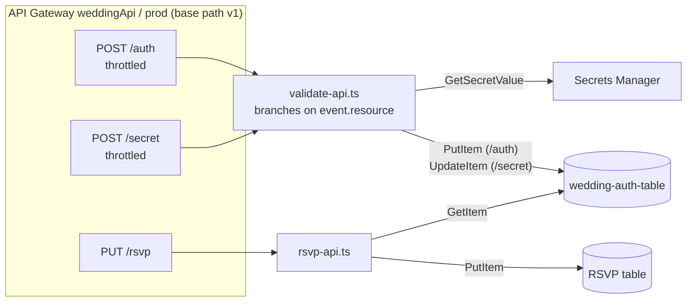

# API Reference

**Base URL:** `https://api.example.com/v1`

`wedding-login` (`AuthService`) and `wedding` (`ApiService`) hard-code this URL. `wedding-secret` makes no API calls. Every request is sent with `withCredentials: true`, so the `api-token` cookie goes along.

**CORS:** origin `https://example.com`, credentials allowed. The Lambdas set the CORS headers on their own responses, and API Gateway adds them to its default 4xx/5xx responses. See [request-flows.md](request-flows.md#cors-preflight-on-api).



## Response codes at a glance

| Status | `POST /auth` | `POST /secret` | `PUT /rsvp` |
|---|---|---|---|
| 200 | correct password, token issued | correct password, token party-approved | RSVP stored |
| 400 | no body, no `password`, bad JSON | same | invalid body (any field missing or of the wrong type), bad JSON |
| 401 | wrong password | wrong password, no cookie, or unknown or expired token | no cookie, or unknown or expired token |
| 429 | over the throttle (API Gateway) | over the throttle (API Gateway) | — |
| 500 | token write failed | update failed for a reason other than the condition | token lookup or RSVP write failed |
| 502 | secret couldn't be read (unhandled error in the Lambda) | same | — |

---

## `POST /auth`

Checks the main guest password and issues a session token.

| | |
|---|---|
| Lambda | `PasswordValidationFunction` → `validate-api.ts` |
| Called from | `wedding-login` → `AuthService.login()` |
| Throttle | 5 req/s, burst 10 (shared by all callers) |

**Request**
```json
{ "password": "..." }
```

**Responses**

| Status | When | Body | Headers |
|---|---|---|---|
| 200 | password matches the `test-secret` key | `{"token":"<uuid>"}` | `Set-Cookie: api-token=<uuid>; Max-Age=5184000; Domain=example.com; Path=/; Secure; SameSite=None; HttpOnly` |
| 401 | wrong password | empty | |
| 400 | no body, no `password` field, or bad JSON | empty | |
| 500 | the DynamoDB `PutItem` failed | empty | no cookie |

Side effect on 200: writes `{uuid, expire: now + 60 days, ttl: expire in seconds}` to `wedding-auth-table`.

---

## `POST /secret`

Checks the after-party password and marks the caller's existing token as party-approved.

| | |
|---|---|
| Lambda | `PasswordValidationFunction` → `validate-api.ts` (same function; it branches on `event.resource === '/secret'`) |
| Called from | `wedding` → `/w/secret` page → `ApiService.postSecret()` |
| Requires | the `api-token` cookie |
| Throttle | 5 req/s, burst 10 |

**Request:** `{ "password": "..." }`

**Responses**

| Status | When | Body |
|---|---|---|
| 200 | password matches the `party-secret` key, and the token exists and hasn't expired | empty, **no new cookie** |
| 401 | wrong password; no cookie; or the conditional update failed (unknown or expired token) | empty |
| 400 | missing or invalid body | empty |
| 500 | the DynamoDB update failed for another reason | empty |

Side effect on 200: `UpdateItem SET party = true` on the token's item, with the condition `attribute_exists(uuid) AND expire > now`. The edge function then allows `/s/*` for that token.

The password is checked before the cookie, so a wrong password gets a 401 whether or not a cookie was sent.

---

## `PUT /rsvp`

Records one guest's RSVP.

| | |
|---|---|
| Lambda | `RsvpFunction` → `rsvp-api.ts` |
| Called from | `wedding` → `/w/rsvp` page → `ApiService.putRsvp()`, once per person, in parallel |
| Requires | the `api-token` cookie |

**Request**
```json
{ "firstName": "Jane", "lastName": "Doe", "phone": "509-555-1234", "attending": true }
```

**Responses**

| Status | When |
|---|---|
| 200 | valid token and valid body → item written |
| 400 | no body, bad JSON, or `isPerson()` failed: a string field is missing, empty or whitespace, or `attending` isn't a boolean |
| 401 | no cookie, or the token is unknown or expired |
| 500 | the token lookup or the RSVP write threw |

Behaviour:
- The token is checked **before** the body, so an invalid body from a guest who isn't logged in gets a 401.
- `firstName`, `lastName` and `phone` are lower-cased before storage.
- The key is `(firstName, lastName)`, so a second submission for the same name **overwrites** the first. This lets guests change their answer.

---

## Shared code

The token and cookie logic is shared with the edge function through two modules; see [components.md](components.md#wedding-cdk-lambda-modules):

- `lambda/auth.ts`: table name, token lifetime, `isTokenItemValid()`, `lookupToken()`.
- `lambda/cookies.ts`: cookie parsing for both CloudFront and API Gateway events.
