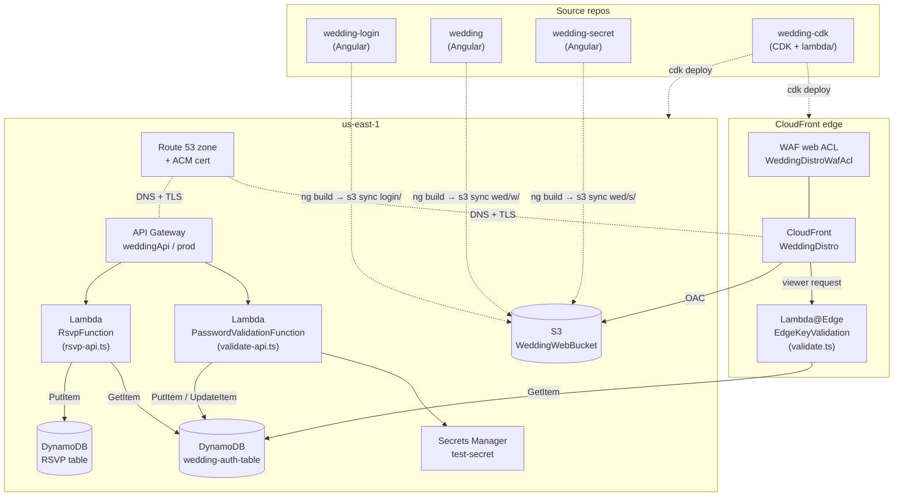
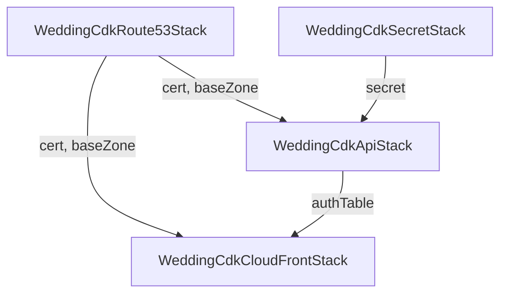
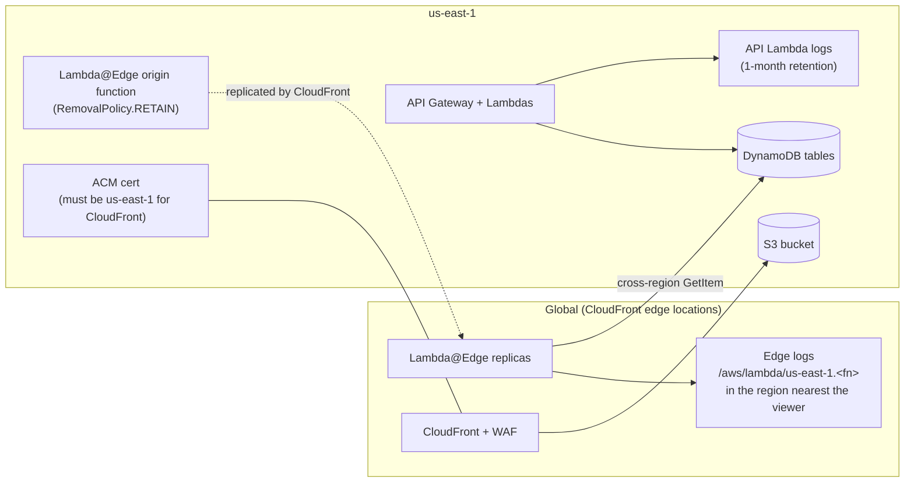

# Architecture

All infrastructure is defined in `wedding-cdk/`. The entry point is `bin/wedding-cdk.ts`. It hard-codes the domain name and the Route 53 hosted zone ID and wires four stacks together.

## Container view

Each repo and the AWS resources it becomes. Solid arrows are runtime calls; dotted arrows show which repo produces which resource.



## CDK stacks



CDK deploys them in dependency order: Route53 → Secret → Api → CloudFront.

| Stack (construct id) | Source | Creates |
|---|---|---|
| `WeddingCdkRoute53Stack` | `lib/wedding-cdk-stack.ts` | Imports the existing public hosted zone. Creates an ACM certificate for `example.com` + `*.example.com`, validated by DNS. |
| `WeddingCdkSecretStack` | `lib/wedding-cdk-secret-stack.ts` | Nothing new. It **imports** an existing, manually created Secrets Manager secret by name (`fromSecretNameV2('test-secret')`). |
| `WeddingCdkApiStack` | `lib/wedding-cdk-api-stack.ts` | Two DynamoDB tables, the REST API, two Lambdas and their log groups, the `api.` custom domain, the base path mapping and the DNS alias record. Outputs `ApiUrl`. |
| `WeddingCdkCloudFrontStack` | `lib/wedding-cdk-web-stack.ts` | S3 bucket, Lambda@Edge function, WAF web ACL, two origin request policies, the CloudFront distribution, and A/AAAA alias records for the apex domain. |

## Region view

Everything is deployed to `us-east-1`. CloudFront copies the Lambda@Edge function to edge locations, and each copy writes its logs to the region nearest the viewer. Every token check still reads DynamoDB in `us-east-1`.



## AWS resources

### DNS & TLS
- **Route 53 hosted zone** `example.com`: pre-existing and imported, not managed by CDK.
- **ACM certificate** covering the apex and the wildcard. CloudFront and the API Gateway custom domain share it.
- **Records:** apex `A` + `AAAA` → CloudFront; `api.` `A` → the API Gateway regional domain.

### Edge: CloudFront + WAF
- **WAF web ACL** `WeddingDistroWafAcl` (scope `CLOUDFRONT`, default allow). Its rules, in priority order:
  0. **GeoMatch:** block any request **not** from `US` or `CA`
  1. `AWSManagedRulesAmazonIpReputationList`
  2. `AWSManagedRulesCommonRuleSet`
  3. `AWSManagedRulesKnownBadInputsRuleSet`

  The ACL is attached only to the distribution. The `api.` domain does **not** go through it; see [security.md](security.md).
- **CloudFront distribution** `WeddingDistro`: HTTPS redirect, default root object `index.html`, compression on for every behaviour.
- **Lambda@Edge** `EdgeKeyValidation` (`lambda/validate.ts`) runs on `VIEWER_REQUEST` for **every** behaviour, with `includeBody: true`. It has **read-only** access to the auth table. The function and its versions are retained on stack delete, because CloudFront replicas can't be deleted right away.

#### CloudFront behaviours

| Path pattern | Origin | Origin path | Cache policy | Origin request policy | Edge Lambda |
|---|---|---|---|---|---|
| default (`/*`) | S3 bucket (OAC) | `/login` | CachingOptimized | `Login-Api-Origin-Request-Policy` (all cookies + query strings) | yes, passes the request through unchanged |
| `/w/*` | S3 bucket (OAC) | `/wed` | CachingOptimized | `Web-Api-Origin-Request-Policy` (all cookies + query strings) | yes, **valid token required** |
| `/s/*` | S3 bucket (OAC) | `/wed` | CachingOptimized | `Web-Api-Origin-Request-Policy` | yes, **valid, party-approved token required** |

CloudFront adds the origin path in front of the full request URI. The resulting S3 keys are:

| Browser requests | S3 key fetched |
|---|---|
| `/` → `/index.html` (default root object) | `login/index.html` |
| `/main-XUCZG3EN.js` | `login/main-XUCZG3EN.js` |
| `/w` | none: the edge function returns a 301 to `/w/` |
| `/w/` → (edge rewrite) `/w/index.html` | `wed/w/index.html` |
| `/w/rsvp` → (edge rewrite) `/w/rsvp/index.html` | `wed/w/rsvp/index.html` |
| `/s/secret` → (edge rewrite) `/s/secret/index.html` | `wed/s/secret/index.html` |

For the full logic of the edge function (redirects, rewrites, the token and party checks, and its error responses), see the [edge decision tree](request-flows.md#edge-decision-tree).

### Storage: S3
- One private bucket (`WeddingWebBucket`), all public access blocked, served only through CloudFront Origin Access Control.
- `removalPolicy: DESTROY` + `autoDeleteObjects: true`: **destroying the stack deletes the site files.**
- CDK does **not** upload the site. The files are built and synced by hand; see [deployment.md](deployment.md).

Expected bucket layout:
```
<bucket>/
├── login/          ← wedding-login/dist/wedding/browser/*
│   ├── index.html
│   └── main-*.js, styles-*.css, ...
└── wed/
    ├── w/          ← wedding/dist/wedding/browser/*
    │   ├── index.html
    │   ├── party/, rsvp/, story/, travel/, registry/, secret/  (each with index.html)
    │   └── main-*.js, assets/, media/, ...
    └── s/          ← wedding-secret/dist/wedding/browser/*
        ├── secret/index.html
        └── w/index.html, main-*.js, assets/, ...
```

### API: API Gateway + Lambda
- **REST API** `weddingApi`, stage `prod`. INFO-level execution logging and metrics are on; **data trace (full request/response logging) is off**. `cloudWatchRole: true` creates the account-level logging role.
- **Throttling:** `POST /auth` and `POST /secret` are limited to 5 requests/second with a burst of 10. These limits are shared by **all** callers, not per IP. Over the limit, API Gateway returns 429.
- **CORS:** preflight allows origin `https://example.com` with credentials. The default 4xx/5xx gateway responses also carry the CORS headers, so the browser can read error statuses.
- **Custom domain:** `api.example.com` (REGIONAL), base path `v1` → stage `prod`.
- **Lambdas:** both are `NodejsFunction`s on Node 24. CDK bundles each one from its `.ts` entry file with esbuild. Each has its own log group with 1-month retention, which is deleted with the stack.
  - `PasswordValidationFunction` → `validate-api.ts`. Env: `SECRET_ARN`, `TABLE_NAME`. Has read/write on the auth table and read on the secret.
  - `RsvpFunction` → `rsvp-api.ts`. Env: `TABLE_NAME`. Has read/write on the RSVP table and read on the auth table.

See [api.md](api.md) for the endpoints and [security.md](security.md#iam-access-matrix) for the full permission list.

### Data: DynamoDB

| Table | Name | Keys | Billing | TTL |
|---|---|---|---|---|
| `WeddingAuthTable` | `wedding-auth-table` (fixed name, because Lambda@Edge can't use environment variables) | PK `uuid` (S) | on-demand | on attribute `ttl` |
| `WeddingRSVPTable` | generated by CloudFormation | PK `firstName` (S), SK `lastName` (S) | on-demand | none |

The item shapes and the read/write map are in [data-model.md](data-model.md).

### Secrets: Secrets Manager
An existing secret named `test-secret` (imported, not created by CDK) holds a JSON object with two keys: `test-secret` (the main password) and `party-secret` (the after-party password). `validate-api` caches the parsed secret in memory for the life of each Lambda container, so after a password change, old containers keep accepting the old password until they are recycled. [deployment.md](deployment.md#updating-later) explains how to force that.
