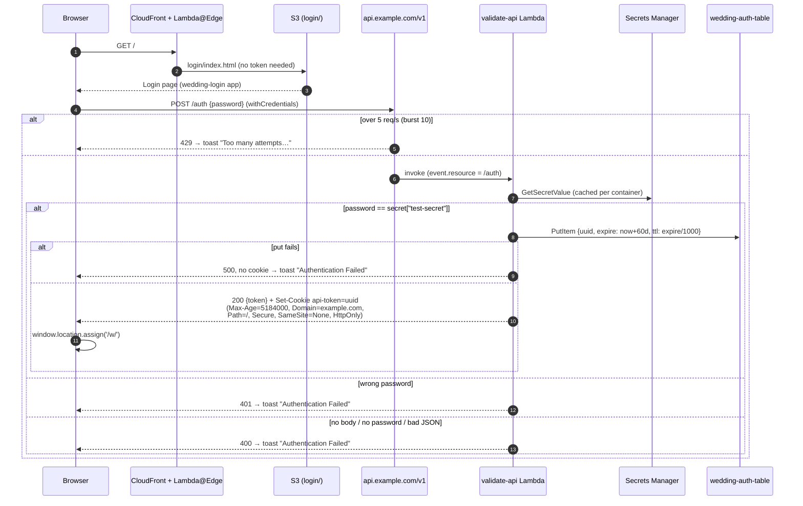
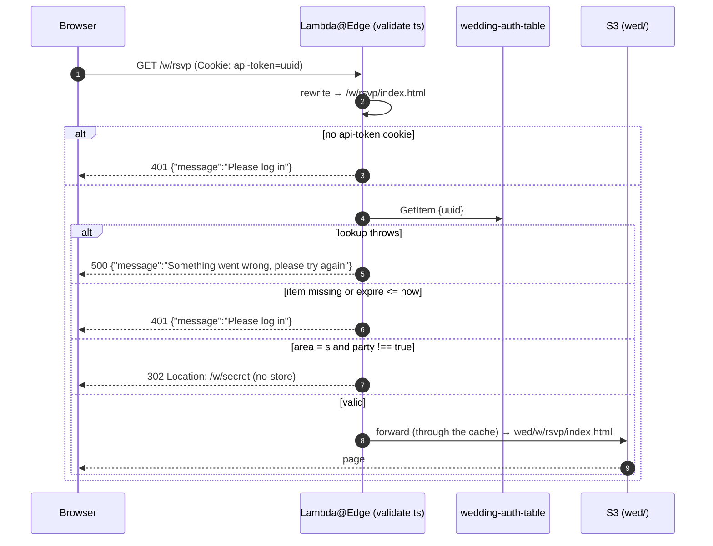
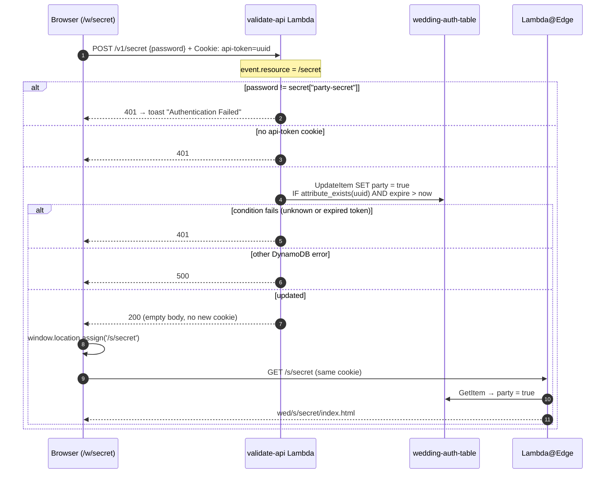
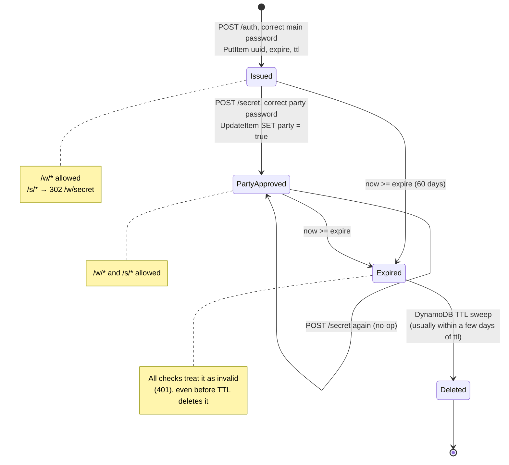
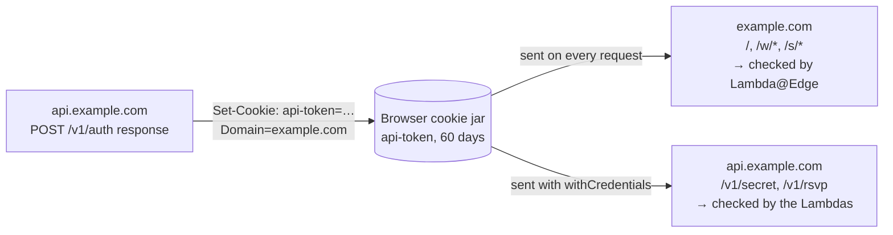

# Authentication

The site uses two shared passwords rather than per-user accounts:

- **Main password** (`test-secret` key): unlocks `/w/`.
- **Party password** (`party-secret` key): unlocks `/s/`, but only for a guest who is already logged in.

A successful login creates a random UUID token. The token is stored in DynamoDB with a 60-day expiry and set as an `api-token` cookie on the parent domain. Lambda@Edge checks it on every request to `/w/` and `/s/`. Entering the party password sets `party = true` on that same token's item, and the edge function requires that flag for `/s/`.

## 1. Main login (`/` → `/w/`)

Notes:
- The login app does a full page load of `/w/` with `window.location.assign` instead of using the Angular router, because `/w/` is a different app behind a different CloudFront behaviour.
- Each login creates a **new** token. Old tokens stay valid until they expire, so a guest who logs in on two devices has two tokens.

## 2. Accessing protected content (`/w/*`, `/s/*`)

Every request under `/w/` and `/s/` is checked, including JS, CSS and images. The full logic, including the 301 for `/w` and the rewrite rules, is in the [edge decision tree](request-flows.md#edge-decision-tree).

Requests outside `/w/` and `/s/` (the login app's files) pass through unchanged.

## 3. After-party unlock (`/w/secret` → `/s/secret`)

The main site's nav has a 🤫 link to `/w/secret`, a second password form (`wedding/src/app/secret`). The browser sends the existing `api-token` cookie with the request, because the cookie's `Domain` covers `api.`.

A logged-in guest who opens `/s/secret` without entering the party password is sent to `/w/secret` by a 302 from the edge function.

## Token lifecycle

One item in `wedding-auth-table`, from creation to deletion:

There is no logout and no way to revoke a single token, short of deleting its item from the table by hand. Changing the main password doesn't invalidate existing tokens.

## Cookie scope

The cookie is set by a response from `api.example.com`, but its `Domain` attribute makes the browser send it to the apex and every subdomain.

| Attribute | Value | Why |
|---|---|---|
| `Max-Age` | `5184000` (60 days) | Matches `TOKEN_LIFETIME_MS`; guests stay logged in across browser restarts |
| `Domain` | `example.com` | So the apex domain (and the edge function) sees a cookie set by `api.` |
| `Path` | `/` | Covers every app |
| `Secure` | yes | HTTPS only |
| `SameSite` | `None` | Lets the cookie be sent on the browser's cross-origin `fetch` to `api.` |
| `HttpOnly` | yes | Page JavaScript can't read it. The login app reads the token from the JSON body only to decide whether to redirect. |

## Summary of auth states

| Guest has… | `/` | `/w/*` | `/s/*` | `PUT /rsvp` | `POST /secret` (correct password) |
|---|---|---|---|---|---|
| no cookie | ✅ login page | ❌ 401 | ❌ 401 | ❌ 401 | ❌ 401 |
| valid token | ✅ | ✅ | ↪️ 302 → `/w/secret` | ✅ | ✅ marks party |
| valid, party-approved token | ✅ | ✅ | ✅ | ✅ | ✅ (no change) |
| expired or unknown token | ✅ | ❌ 401 | ❌ 401 | ❌ 401 | ❌ 401 |
