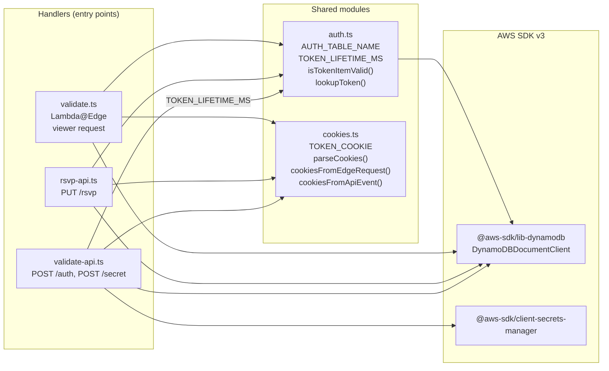
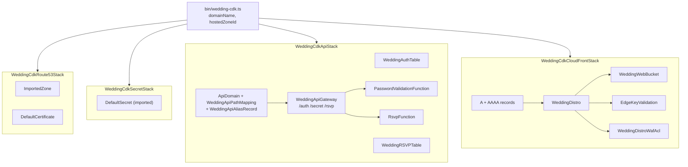
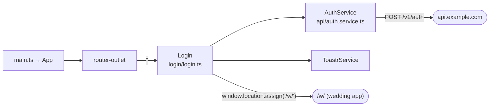
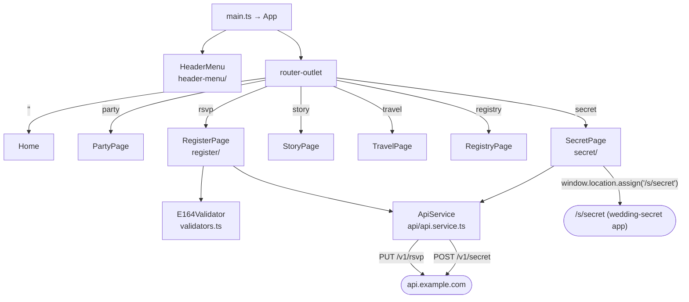
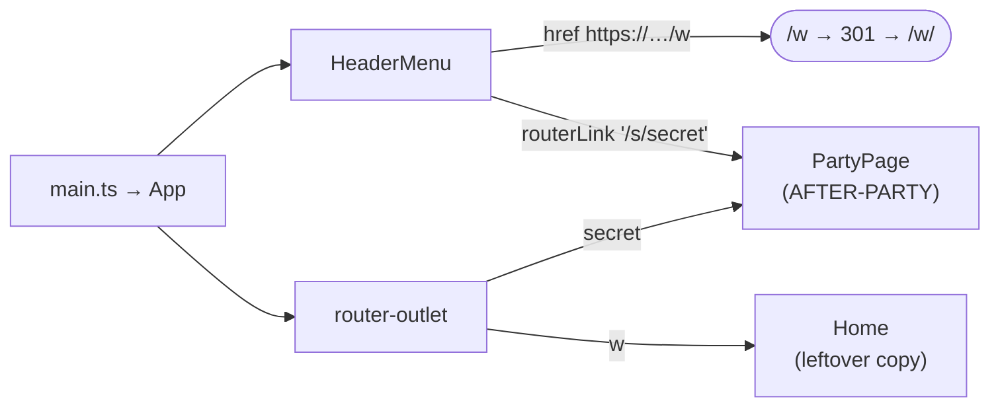
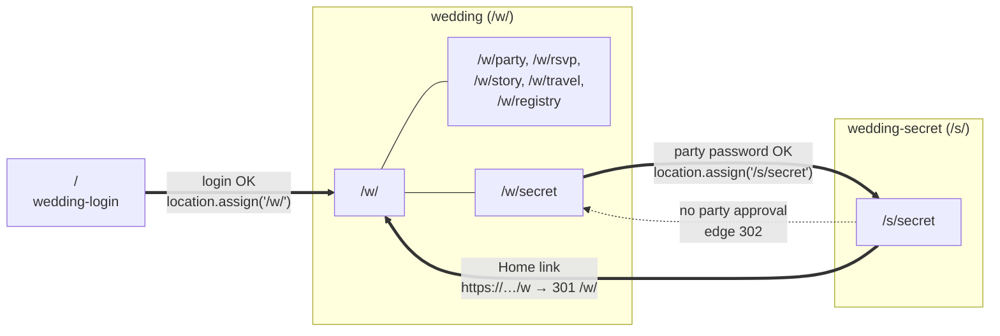

# Components

What is inside each repo and how the parts depend on each other. For the AWS resources these become, see [architecture.md](architecture.md).

## `wedding-cdk`: Lambda modules

Three handlers share two helper modules. Each handler is bundled separately by esbuild, so the shared code is copied into each bundle.

| Module | Exports | Used by |
|---|---|---|
| `lambda/auth.ts` | `AUTH_TABLE_NAME` (`wedding-auth-table`), `TOKEN_LIFETIME_MS` (60 days), `isTokenItemValid(item)` (item exists and `expire > now`), `lookupToken(client, token)` (GetItem) | `validate.ts`, `rsvp-api.ts`, `validate-api.ts` (lifetime only), and `lib/wedding-cdk-api-stack.ts` (table name) |
| `lambda/cookies.ts` | `TOKEN_COOKIE` (`api-token`), `parseCookies(values)` (the first value wins for duplicate names), `cookiesFromEdgeRequest(req)`, `cookiesFromApiEvent(event)` (prefers `multiValueHeaders`, case-insensitive header name) | all three handlers |
| `lambda/validate.ts` | `handler`, plus the testable helpers `protectedArea`, `rewriteToIndex`, `trailingSlashRedirect`, `unauthorized`, `partyRequired`, `serverError` | CloudFront (all behaviours) |
| `lambda/validate-api.ts` | `handler`. Internally: `getSecret()` (cached for the container's lifetime), `markPartyApproved(token)` (conditional UpdateItem) | API Gateway `POST /auth`, `POST /secret` |
| `lambda/rsvp-api.ts` | `handler`. Internally: `isPerson()` validation | API Gateway `PUT /rsvp` |

### Tests

`npm test` runs Jest over `wedding-cdk/test/`. All of them are unit tests with the AWS SDK mocked. There are no tests of the CDK stacks themselves (no synth or snapshot tests).

| File | Covers |
|---|---|
| `auth.test.ts` | `isTokenItemValid`: future, past, exactly-now and missing `expire`; a missing item |
| `cookies.test.ts` | Cookie parsing edge cases, and edge vs. API Gateway header formats |
| `validate.test.ts` | Each helper, plus the handler: 301, 401 (no cookie, unknown, expired, no `expire`), party redirect vs. 401 for an expired party token, 500 without leaking details |
| `validate-api.test.ts` | `/auth` success, wrong password, failed table write; request validation; routing by `event.resource`; `/secret` approval, missing cookie, unknown or expired token, update failure |
| `rsvp-api.test.ts` | 401 without a cookie (DynamoDB untouched), token lookup, 500 on lookup failure, lower-casing, `attending: false`, failed write |

## `wedding-cdk`: stacks and constructs

## `wedding-login`

- `Login` has a reactive form with one required `password` field and a spinner while the request is in flight.
- On a 200 with a non-empty `token`, it does a full page load of `/w/`. On a 429 it shows "Too many attempts…"; on any other error, "Authentication Failed".
- `validators.ts` (the `E164Validator`) is copied from the main app and isn't used here.

## `wedding`

- `HeaderMenu` links use absolute `routerLink="/…"`, which resolve under the `/w/` base href. On small screens it collapses into a hamburger menu.
- `RegisterPage` keeps a `FormArray` of people (one, or two with the plus-one toggle) and sends one `PUT /rsvp` per person in parallel with `forkJoin`. See the [RSVP flow](request-flows.md#rsvp-submit-with-a-plus-one).
- `SecretPage` has the after-party password form. See the [party unlock flow](auth-flow.md#3-after-party-unlock-wsecret--ssecret).

## `wedding-secret`

- It makes no API calls and has no `ApiService`.
- `PartyPage` shows `assets/img/lan.png` and `lan_info.png`.
- The `/s/w` route is a leftover copy of the main home page.
- The 🤫 link uses `routerLink="/s/secret"`, which under the `/s/` base href probably resolves to `/s/s/secret`. That path matches no route. This hasn't been checked in a browser.

## Cross-app navigation

Moving between the three apps always means a full page load through CloudFront, so the edge function runs again. Moving within one app uses the Angular router.

Thick arrows are full page loads. Thin lines are router navigation within one app. The dotted arrow is a server-side redirect.
