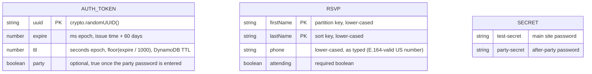
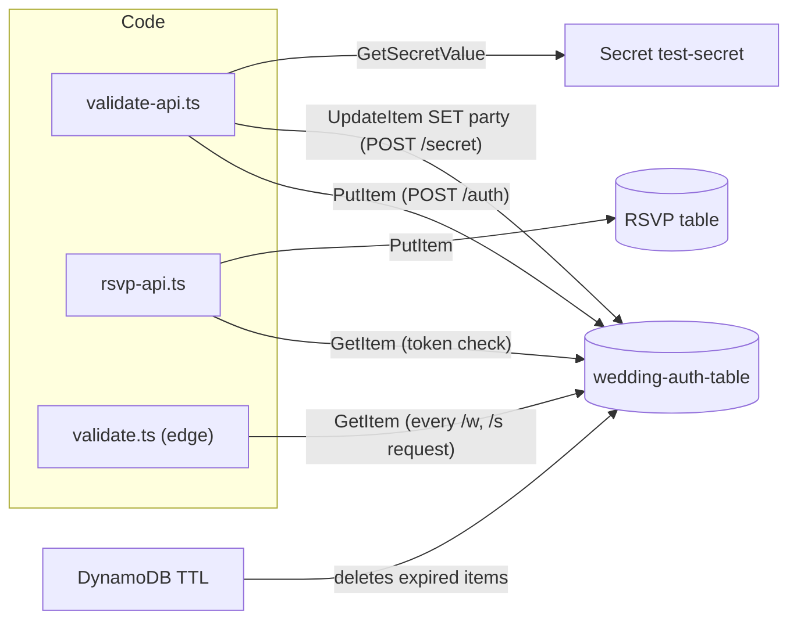

# Data Model

The system stores three things: login tokens, RSVPs, and the two passwords. There is no relationship between a token and an RSVP; RSVPs aren't linked to the guest who submitted them.

## Entities



### `wedding-auth-table`

| Attribute | Type | Set by | Read by | Notes |
|---|---|---|---|---|
| `uuid` | S (partition key) | `validate-api` on `POST /auth` | `validate.ts`, `rsvp-api`, `validate-api` (`/secret`) | Same value as the `api-token` cookie |
| `expire` | N (ms) | `validate-api` on `POST /auth` | `isTokenItemValid()` everywhere, and the condition in `markPartyApproved()` | A token is valid while `expire > Date.now()` |
| `ttl` | N (s) | `validate-api` on `POST /auth` | DynamoDB TTL | Cleanup only. Deletion can lag by days, which is why the code checks `expire` itself. |
| `party` | BOOL | `validate-api` on `POST /secret` | `validate.ts` for `/s/*` | Absent until set; never unset |

Example:
```json
{ "uuid": "27ca9da4-…", "expire": 1789000000000, "ttl": 1789000000, "party": true }
```

### RSVP table

The name is generated by CloudFormation; look for `WeddingCdkApiStack-WeddingRSVPTable…`.

| Attribute | Type | Notes |
|---|---|---|
| `firstName` | S (partition key) | Lower-cased |
| `lastName` | S (sort key) | Lower-cased |
| `phone` | S | Lower-cased, otherwise stored as typed (for example `509-555-1234`). Validated as E.164 only in the browser; the Lambda only checks that it is non-empty. |
| `attending` | BOOL | Must be a JSON boolean, otherwise 400 |

Behaviour:
- `PutItem` without a condition: submitting the same first and last name again **overwrites** the earlier answer. This lets guests change their RSVP, but two different guests with the same name would overwrite each other.
- No timestamp is stored, so you can't tell when an RSVP was made or changed.
- Nothing in the system reads this table. View it in the DynamoDB console or with `aws dynamodb scan`.

### Secret `test-secret` (Secrets Manager)

```json
{ "test-secret": "<main password>", "party-secret": "<after-party password>" }
```

It is created by hand, outside CDK. `validate-api` reads it once per Lambda container and caches it.

## Read/write map



## Retention

| Data | How long it lives | On `cdk destroy` |
|---|---|---|
| Auth tokens | Until TTL deletes them, a little after 60 days | Table **retained** (CDK default). Delete it by hand before redeploying, because its fixed name conflicts. |
| RSVPs | Forever | Table **retained** with its data |
| Passwords | Until changed | Not managed by CDK, so untouched |
| API Lambda logs | 1 month | Log groups deleted |
| Edge Lambda logs | No retention set (kept forever) | Left behind in every region where they were written |
