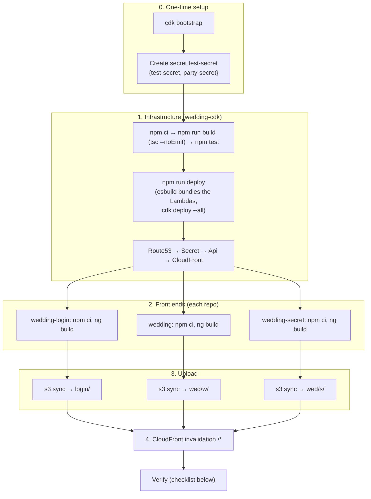

# Build & Deployment

> This records how the original system was built and deployed. The commands are kept for reference only and need the private repos. The demo's own commands are in the [root README](../README.md).

CDK handles the infrastructure. The website files are built and uploaded to S3 by hand, as a separate step.

These steps are written for a first deploy into an account where none of the stacks exist yet. [Updating later](#updating-later) covers redeploying after that.



Front-end-only changes skip steps 0 and 1. Infrastructure-only changes skip steps 2 to 4.

## Prerequisites

- AWS CLI + credentials for the target account
- `CDK_DEFAULT_REGION` / your profile region set to **`us-east-1`** (required for Lambda@Edge, the CloudFront ACM cert and the CLOUDFRONT-scope WAF)
- Node.js (Angular 21 needs Node 20.19+; Lambdas run Node 24)
- A Route 53 public hosted zone for `example.com`, created outside CDK (ID hard-coded in `bin/wedding-cdk.ts`)

Docker isn't needed. `esbuild` is a dev dependency of `wedding-cdk`, so CDK bundles the Lambdas locally.

## 0. One-time setup

Bootstrap CDK in the account/region:

```bash
cd wedding-cdk
npx cdk bootstrap
```

Create the Secrets Manager secret in `us-east-1`, outside CDK. CDK looks it up **by name**, so it must be called `test-secret`. Its value is a JSON object with two keys:

| Key | Holds |
|---|---|
| `test-secret` | The main site password (`POST /auth`) |
| `party-secret` | The after-party password (`POST /secret`) |

Use strong passwords, for example three or more random words. The password endpoints are throttled, but the throttle is shared by all callers, so password length is the real protection against guessing.

## 1. Infrastructure (`wedding-cdk`)

```bash
cd wedding-cdk
npm ci
npm run build            # type-check only (tsc --noEmit)
npm test
npx cdk diff
npm run deploy           # type-checks, then cdk deploy --all
```

Each Lambda is a `NodejsFunction`: CDK bundles it from its `.ts` file with esbuild during synth, so there is no separate compile step and no stale `.js` to worry about.

Stack order (CDK resolves this from the dependencies): Route53 → Secret → Api → CloudFront.

The first deploy waits for the ACM certificate's DNS validation, which can take several minutes.

Lambda@Edge changes take several minutes to replicate to every edge location. Old function versions are retained on purpose (`RemovalPolicy.RETAIN`).

## 2. Front ends

Build each app:

```bash
(cd wedding-login  && npm ci && npx ng build)
(cd wedding        && npm ci && npx ng build)
(cd wedding-secret && npm ci && npx ng build)
```

Output for each is in `<app>/dist/wedding/browser/`.

The apps build as static sites (`outputMode: "static"`), with no server bundle. Every route is prerendered into its own `index.html` (for example `story/index.html`). Keep prerendering on: the edge function rewrites `/w/story` to `/w/story/index.html`, so a route without its own file returns an S3 error.

## 3. Upload to S3

Find the bucket name. It is auto-generated and starts with `weddingcdkcloudfrontstack-weddingwebbucket`:

```bash
aws s3 ls | grep -i weddingwebbucket
BUCKET=<name>
```

Sync each app to its prefix (see the layout in [architecture.md](architecture.md#storage-s3)):

```bash
aws s3 sync wedding-login/dist/wedding/browser  s3://$BUCKET/login/  --delete
aws s3 sync wedding/dist/wedding/browser        s3://$BUCKET/wed/w/  --delete
aws s3 sync wedding-secret/dist/wedding/browser s3://$BUCKET/wed/s/  --delete
```

Don't run `--delete` against `s3://$BUCKET/wed/`: the `w/` and `s/` apps share that prefix, and syncing one app there would delete the other.

## 4. Invalidate the CloudFront cache

Every S3 behaviour uses `CachingOptimized`. File names with a hash (`main-*.js`) are safe, but `index.html` files stay cached until they are invalidated:

```bash
DOMAIN=<your domain>    # the domainName value in wedding-cdk/bin/wedding-cdk.ts
DIST_ID=$(aws cloudfront list-distributions \
  --query "DistributionList.Items[?contains(Aliases.Items, '$DOMAIN')].Id" --output text)
aws cloudfront create-invalidation --distribution-id $DIST_ID --paths "/*"
```

Compression is on for every behaviour. CloudFront caches compressed and uncompressed copies separately, so if compression is ever turned on for a distribution that already has cached files, invalidate `/*` to clear the uncompressed ones.

## Verifying a deploy

1. `https://example.com/` → login page loads. Wrong password → "Authentication Failed" toast. Right password → redirected to `/w/`.
2. In a private window, `/w/` → 401 `{"message":"Please log in"}`. `/w` (no trailing slash) → 301 to `/w/`.
3. Logged in, `/s/secret` → redirected to `/w/secret`. Enter the party password → `/s/secret` loads.
4. Submit an RSVP with a plus-one → one success toast, and two items in the RSVP DynamoDB table.
5. `curl -X PUT https://api.example.com/v1/rsvp` with no cookie → 401.
6. In DevTools, a JS file's response has `content-encoding: br` or `gzip`.
7. Logs: the API Lambdas log to CloudWatch in `us-east-1`, kept for 1 month. **Lambda@Edge logs to the region nearest the viewer**, in log group `/aws/lambda/us-east-1.<function-name>`. New log lines should contain no passwords, tokens or phone numbers.

## Updating later

| Change | Steps |
|---|---|
| Lambda or infrastructure code | `npm run deploy` in `wedding-cdk`. Edge function changes take several minutes to replicate. |
| A front end | Build that app, sync its prefix ([step 3](#3-upload-to-s3)), invalidate ([step 4](#4-invalidate-the-cloudfront-cache)). |
| A password | `aws secretsmanager put-secret-value --secret-id test-secret` with the full JSON (both keys). `validate-api.ts` caches the secret per Lambda container, so force new containers afterwards, for example with `aws lambda update-function-configuration` on the password validation function (any change, such as its description). |

## Tearing down

`npx cdk destroy --all`:

- Deletes the S3 bucket **and its contents**.
- Deletes the API Lambdas' log groups (`RemovalPolicy.DESTROY`). Lambda@Edge log groups in other regions are left behind.
- Retains the DynamoDB tables (the CDK default), so RSVP data survives the destroy.
- Retains the Lambda@Edge functions, which have to be deleted by hand once their replicas are gone.

**Before redeploying after a destroy**, delete the retained `wedding-auth-table` by hand. It has a fixed name, so the next deploy fails with "table already exists" while the old one is there. It only holds login tokens, so deleting it is safe. The RSVP table has a generated name, so it doesn't conflict, but the old one stays behind with its data until you delete it.
