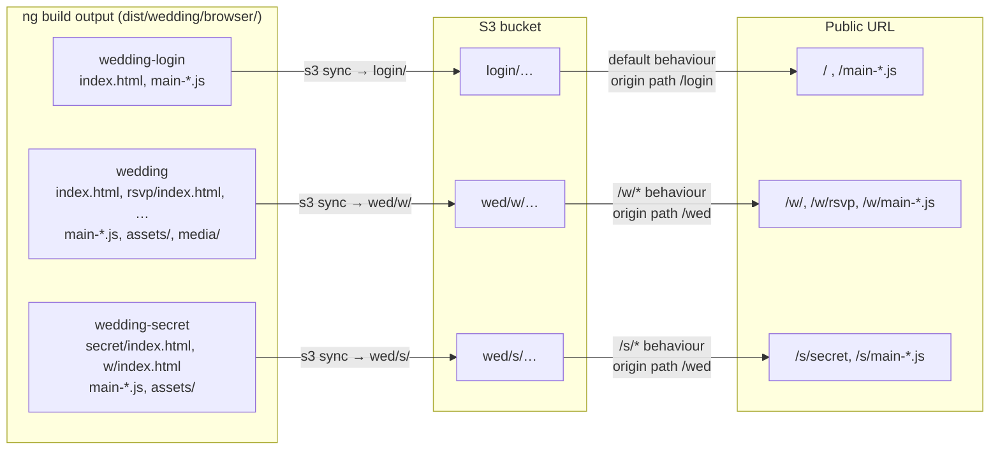

# Front-end Apps

All three apps were scaffolded from the same Angular CLI template and upgraded to **Angular 21.1**. They share most of their boilerplate:

- Standalone components, `provideRouter`, client hydration, and `ngx-toastr` for notifications. The two apps that call the API also use `provideHttpClient`.
- `outputMode: "static"` in `angular.json`, with every route set to `RenderMode.Prerender` in `app.routes.server.ts`. The build is a set of static files with no server bundle; `main.server.ts` is only used to prerender at build time.
- A copy of the `E164Validator` phone validator (`google-libphonenumber`) in `src/app/validators.ts`. Only `wedding` uses it.
- `package.json` has `name: "wedding"` in all three, so the build output always goes to `dist/wedding/browser/`.

For component diagrams of each app, see [components.md](components.md).

## Why `baseHref` matters

CloudFront routes by path prefix, so each app must emit URLs under its own prefix. Otherwise its JS and CSS requests would land on the wrong behaviour, usually the login app's default behaviour.

| App | `baseHref` / `deployUrl` (angular.json) | CloudFront behaviour |
|---|---|---|
| `wedding-login` | *(none, root)* | default `/*` → `login/` |
| `wedding` | `/w/` | `/w/*` → `wed/` |
| `wedding-secret` | `/s/` | `/s/*` → `wed/` |

The comment in `wedding-cdk-web-stack.ts` says it directly: *"This requires baseHref to be set in Angular config for all index.html files."*

### Build output → S3 key → URL

Prerendering matters: the edge function rewrites `/w/rsvp` to `/w/rsvp/index.html`, so every route must have its own `index.html` in the build. There is no SPA fallback to the root `index.html`.

---

## `wedding-login`: login page

| Route | Component | Purpose |
|---|---|---|
| `/` | `Login` | Password form → `AuthService.login()` → on success `window.location.assign('/w/')` |

- `src/api/auth.service.ts` calls `POST /v1/auth`.
- The login button shows a spinner while the request is in flight.
- Error toasts: 429 → "Too many attempts, please wait and try again"; anything else → "Authentication Failed". A 200 without a token → "Failed to authenticate".

## `wedding`: main site (`/w/`)

| Route | Component | Content |
|---|---|---|
| `/w/` | `Home` | Hero: "Spokane · 10/03/2026 · We're getting married · Don't come to the wedding · Come to the party" |
| `/w/party` | `PartyPage` | Party details: who/what/when/where, dress code, food (David's Pizza truck), drinks, cake |
| `/w/rsvp` | `RegisterPage` | RSVP form, see below |
| `/w/story` | `StoryPage` | "Our Story": how the couple met (middle-school band class) |
| `/w/travel` | `TravelPage` | Hotel suggestions (Davenport, Davenport Tower, …) |
| `/w/registry` | `RegistryPage` | "No registry": points to Beavers Northwest, plus a joke "reverse registry" |
| `/w/secret` | `SecretPage` | 🤫 second password form → `POST /v1/secret` → on success `window.location.assign('/s/secret')` |

**Header menu** (`header-menu/`): a responsive nav with a hamburger toggle on small screens. Links use absolute `routerLink="/…"`, which resolve under the `/w/` base href.

**RSVP form** (`register/`):
- A reactive `FormArray` of people. It starts with one person, and a "plus one" toggle adds or removes a second.
- Each person has `firstName`, `lastName`, `phone` (required, E.164 validation for the US region) and `attending` (default `true`).
- Submit sends one `PUT /v1/rsvp` per person in parallel (`forkJoin`) and shows a **single** toast: "Registration successful!", "Please log in again" (any 401) or "Registration failed". One request can succeed while the other fails; see [request-flows.md](request-flows.md#rsvp-submit-with-a-plus-one).

**Secret page** (`secret/`): error toasts work the same way as on the login page (429 vs. other).

**Static assets:** 15 images in `src/assets/img`, `favicon.ico` in `public/`, plus a hashed `media/` image produced by the build.

## `wedding-secret`: after-party (`/s/`)

| Route | Component | Content |
|---|---|---|
| `/s/secret` | `PartyPage` | "AFTER-PARTY" page: `lan.png` and `lan_info.png` |
| `/s/w` | `Home` | Copy of the main site's home page, left over from cloning `wedding` |

- It makes no API calls (no `ApiService`, no `provideHttpClient`).
- Header menu: "Home" is a plain link to `https://example.com/w`, which the edge function 301s to `/w/`. The 🤫 link is `routerLink="/s/secret"`, which under the `/s/` base href probably resolves to `/s/s/secret` and matches no route. This hasn't been checked in a browser.
- The edge function only serves this app to party-approved tokens. Everyone else is redirected to `/w/secret`.

---

## Local development

Each app runs on its own with `npm start` (`ng serve`, http://localhost:4200). Things to know:
- API calls go to the **production** API (`api.example.com`), and CORS only allows `https://example.com`, so **API calls fail from localhost**. You can still work on layout and content locally.
- `wedding` and `wedding-secret` serve under `/w/` and `/s/` locally too, because of `baseHref`.
- Cross-app navigation (`/w/`, `/s/secret`) uses full page loads, so it only works on the real domain.
