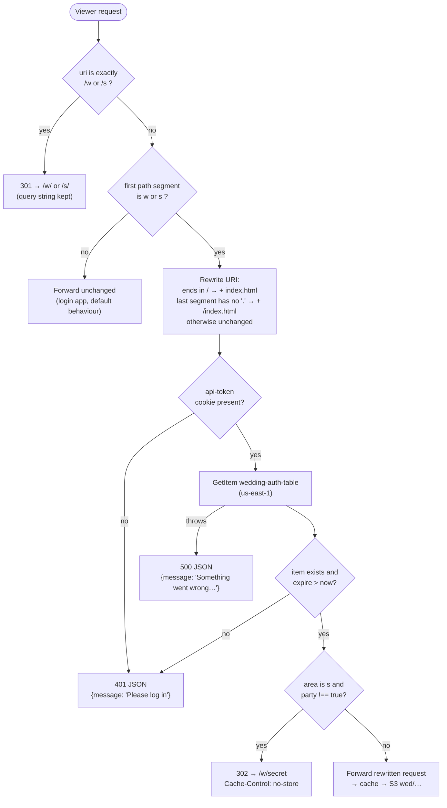
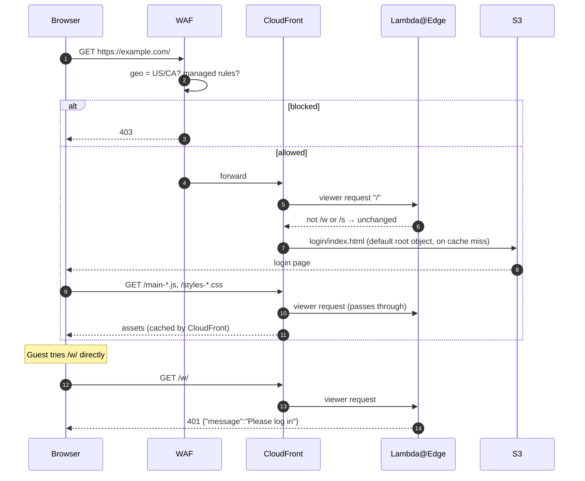
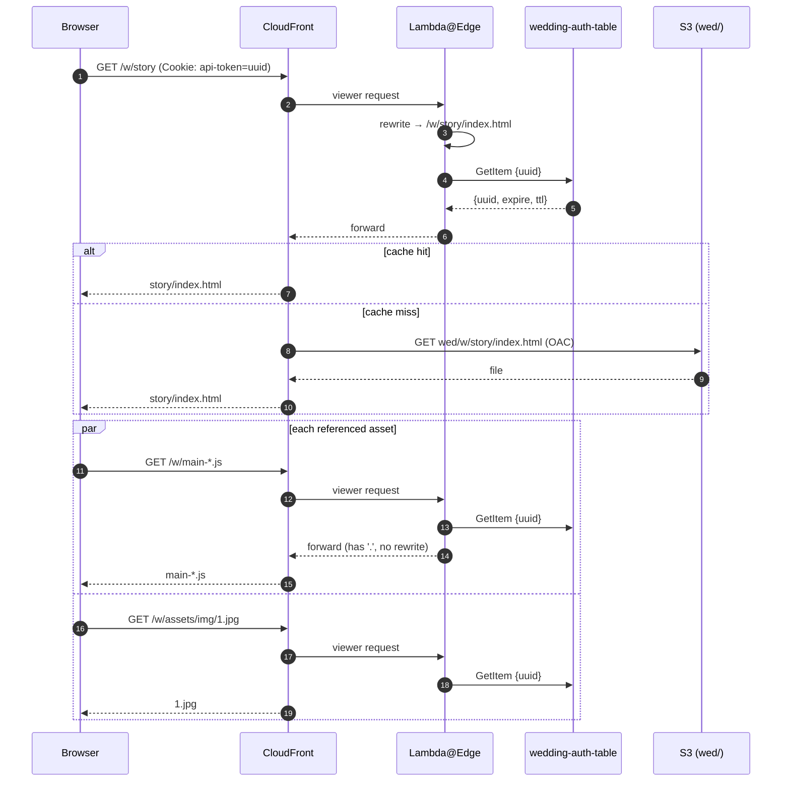
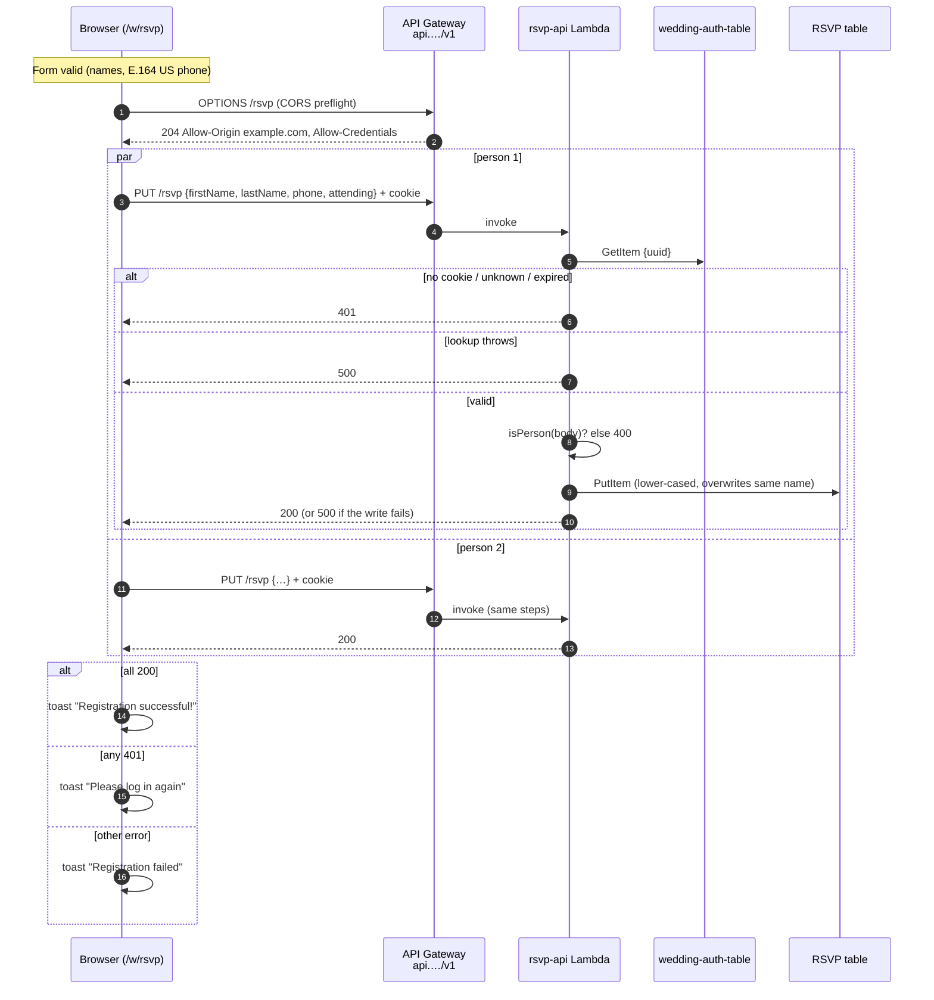
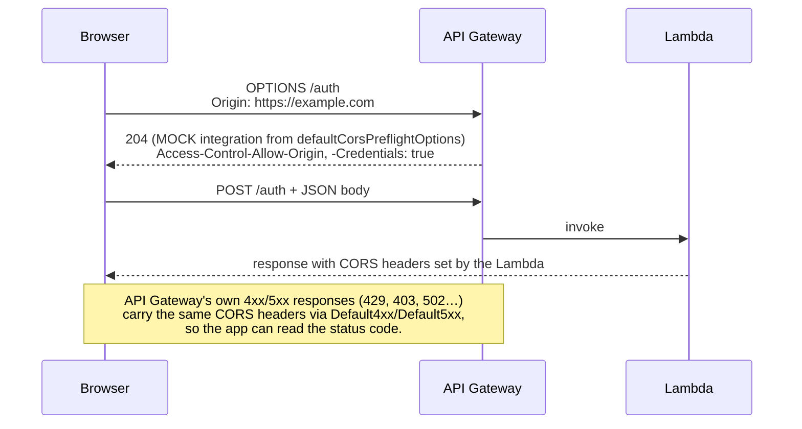
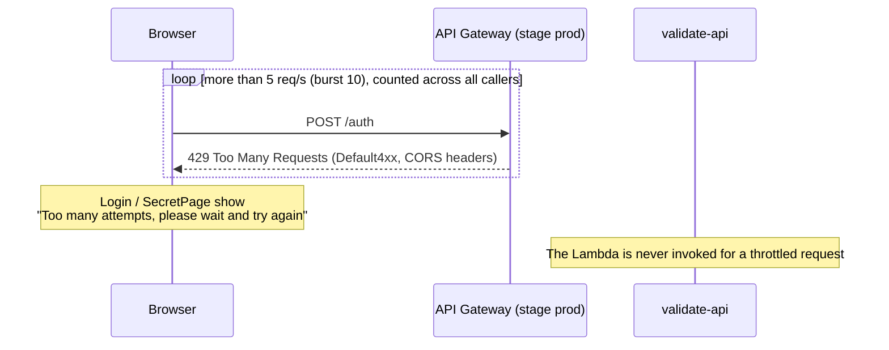
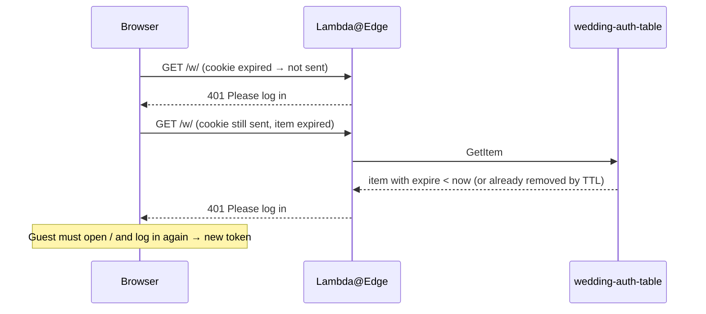

# Request Flows

What happens to each kind of request, end to end. The login and after-party flows are in [auth-flow.md](auth-flow.md). This page covers routing, page and asset loads, the RSVP form, and the error paths.

## Edge decision tree

`lambda/validate.ts` runs on the viewer request of **every** CloudFront behaviour, before the cache. WAF has already allowed the request by this point.

Notes:
- The expiry check comes before the party check, so an expired party-approved token gets a 401, not a 302.
- The 401 is a raw JSON response. Nothing redirects the guest to the login page, so a guest whose token expired sees `{"message":"Please log in"}` and has to go to `/` themselves.
- The 301 also runs for the bare `/w` and `/s` before any token check, so it works without a cookie.

## First visit, no cookie

## Loading a protected page and its assets

Once logged in, every file under `/w/` or `/s/` (HTML, JS, CSS, images) goes through the full edge check. Each one costs a DynamoDB `GetItem` from the edge location to `us-east-1`, even when CloudFront already has the file cached, because viewer-request functions run before the cache.

After the first load, clicking a nav link inside the `wedding` app uses the Angular router. It renders client-side and makes no new HTML request; only images not yet loaded are fetched.

## RSVP submit with a plus-one

`forkJoin` fails as soon as one request fails, but the other request may already have been written. A failed toast can therefore mean one of the two people was saved. Submitting again is safe, because the `(firstName, lastName)` key makes the write an overwrite.

## CORS preflight on `api.`

The pages are served from `example.com` and the API from `api.example.com`, so every API call is cross-origin. JSON bodies and `withCredentials` mean the browser sends a preflight first.

From `localhost` the preflight succeeds at the HTTP level, but the browser rejects it because the allowed origin doesn't match. That is why API calls don't work during local development.

## Throttled login (429)

## Returning guest with an expired token

The cookie and the token item both last 60 days, so they usually expire together. The browser drops the cookie and the edge function sees no cookie. If clocks or a manual table edit make them differ, the edge function sees an expired item instead. The result is the same either way.

