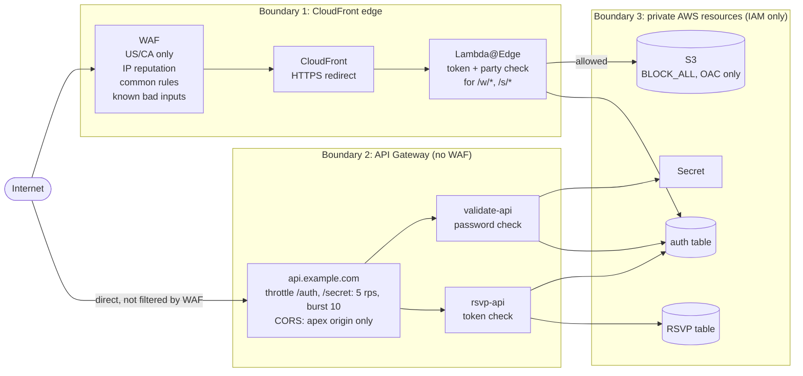

# Security

How the site is protected, layer by layer: what each layer covers, which permissions each function has, and where personal data lives.

## Trust boundaries

What each layer covers:

| Layer | Protects | Doesn't cover |
|---|---|---|
| WAF (geo + managed rules) | All page traffic on `example.com` | The `api.` domain. API Gateway has its own endpoint, and the ACL is attached only to the distribution. |
| Lambda@Edge | `/w/*` needs a valid token; `/s/*` also needs `party = true` | The login app (`/`), which is public by design |
| API Gateway throttling | Slows password guessing on `/auth` and `/secret` | It is a **shared** limit, so one client can use it all up and block real guests. It doesn't apply to `/rsvp`. |
| Lambda token check | `PUT /rsvp` and `POST /secret` need a valid token | `POST /auth`, which is public by design |
| CORS | Stops other websites' scripts from reading API responses in a browser | Non-browser clients such as `curl`, which ignore CORS |
| S3 OAC + `BLOCK_ALL` | The bucket is reachable only through the distribution | — |

## Passwords and tokens

- **Two shared passwords**, stored in Secrets Manager and compared with `!==` in `validate-api`. Password strength is the main defence against guessing; see the advice in [deployment.md](deployment.md#0-one-time-setup).
- **Tokens** are `crypto.randomUUID()` values (122 random bits), valid for 60 days. Validity is checked against `expire` on every use, and TTL removes old items.
- **Party approval** is stored on the token item, so it ends when the token expires.
- **No revocation.** Rotating the main password doesn't log anyone out. To force everyone out, delete the items in `wedding-auth-table` (or empty the table).
- **Secret caching:** a password change takes effect only in new Lambda containers; see [deployment.md](deployment.md#updating-later).

## Cookie and CORS settings

The `api-token` cookie is `Secure`, `HttpOnly`, `SameSite=None`, scoped to `Domain=example.com`, with a 60-day `Max-Age`. [auth-flow.md](auth-flow.md#cookie-scope) explains each attribute.

CORS is configured in three places, which must agree:

| Where | Origin | Methods |
|---|---|---|
| API Gateway preflight (`defaultCorsPreflightOptions`) | `https://example.com` | all |
| Gateway responses `Default4xx` / `Default5xx` | `https://example.com` | `GET,POST,PUT,OPTIONS` |
| Lambda response headers | `https://example.com` | `validate-api`: `GET,POST,OPTIONS`; `rsvp-api`: `GET,POST,PUT,OPTIONS` |

## IAM access matrix

Derived from the `grant*` calls in the CDK stacks.

| Principal | Auth table | RSVP table | Secret | Other |
|---|---|---|---|---|
| `EdgeKeyValidation` (Lambda@Edge) | read (`grantReadData`) | — | — | — |
| `PasswordValidationFunction` | read/write (`grantReadWriteData`) | — | read (`grantRead`) | its log group |
| `RsvpFunction` | read (`grantReadData`) | read/write (`grantReadWriteData`) | — | its log group |
| CloudFront (OAC) | — | — | — | `s3:GetObject` on the bucket (added by `S3BucketOrigin.withOriginAccessControl`) |
| API Gateway | — | — | — | Invoke on the two Lambdas (added by `LambdaIntegration`); CloudWatch logging role (`cloudWatchRole: true`) |

`grantReadWriteData` is broader than each function needs. `rsvp-api` only calls `PutItem` on the RSVP table, and `validate-api` only calls `PutItem` and `UpdateItem` on the auth table.

## Personal data

| Data | Where | Who can see it |
|---|---|---|
| Guest names, phone numbers, attendance | RSVP table | Anyone with DynamoDB read access in the account |
| Login tokens | Auth table; guests' browsers | Same as above |
| Request logs | API Gateway execution logs (INFO level, **no** request bodies, because data trace is off); Lambda logs (the handlers log only generic error messages) | Anyone with CloudWatch Logs access |
| Client IPs and countries | WAF sampled requests and metrics | Anyone with WAF access |
